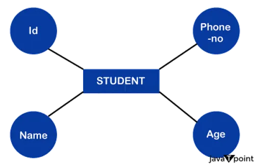
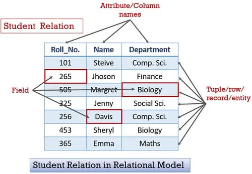

# Database Management System

## Introduction

### Data
- Any fact that can be recorded or stored

### Databse 
- Collection of Data

### Database Managemet System 
- Program(or Software) which is used to construct, manioulate and retrive the data in database

## Data model and its types

### Data Model
- Used to represent the structure of data in database
    - ER Model => Diagramatic representation 
    
    - Relational Model => Representation using a collection of tables 
    

### Terminologies
- Table => Relation 
- Row => Record
- Column => Field